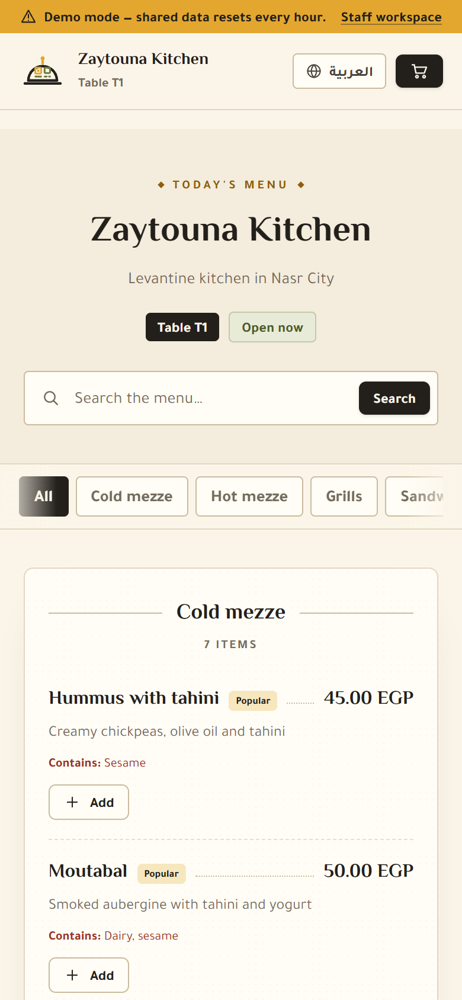
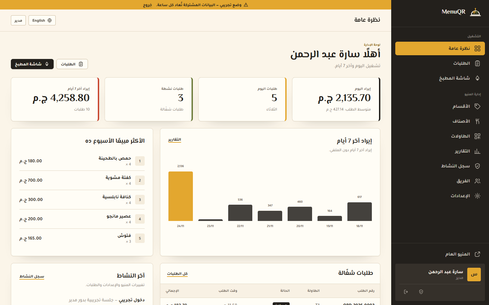
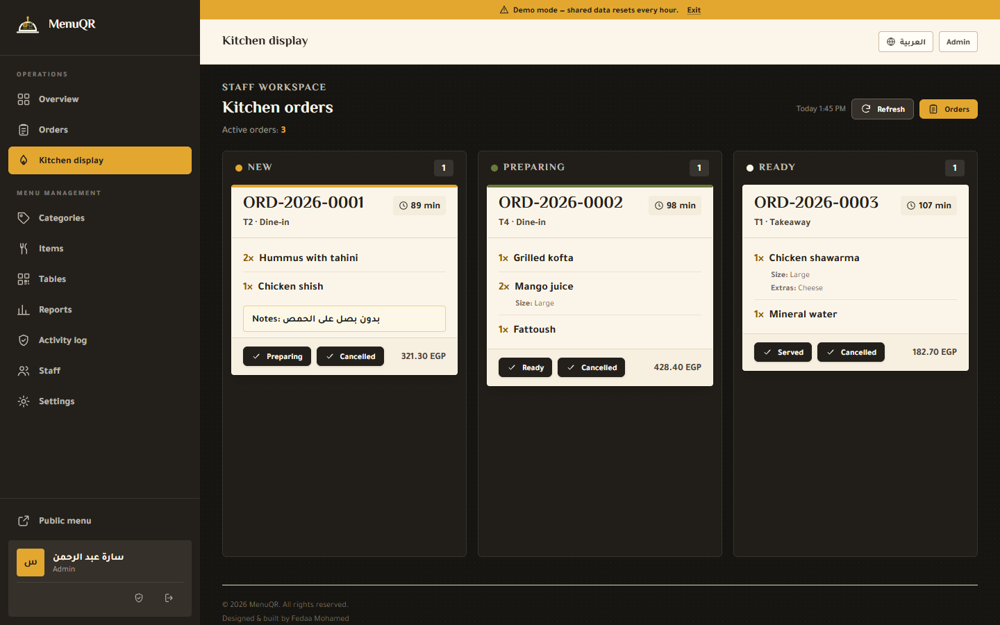
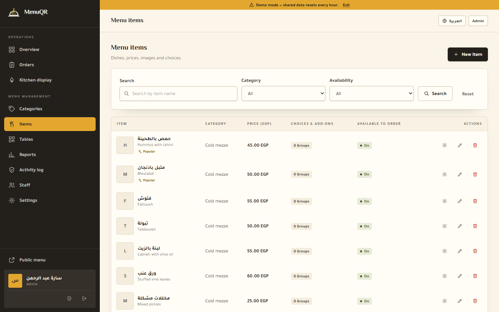
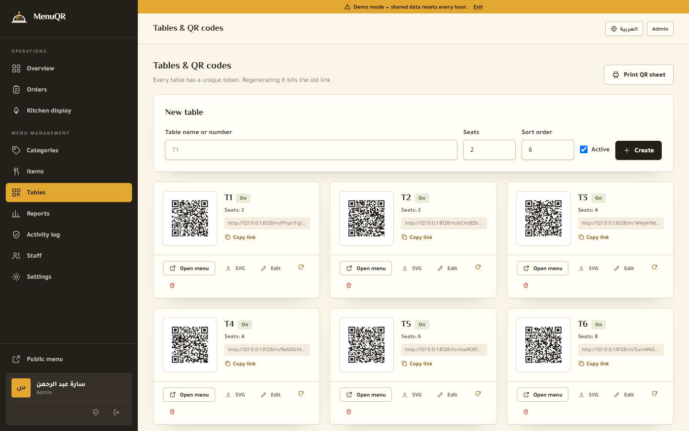
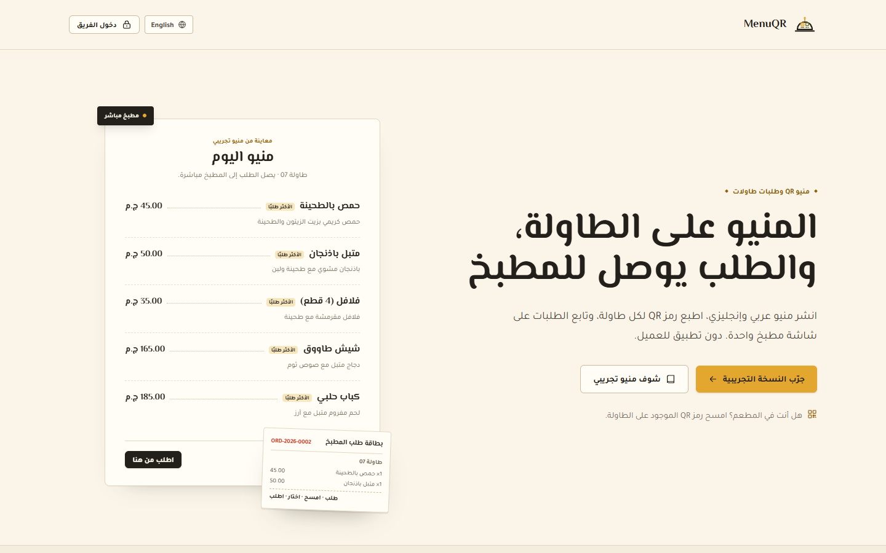
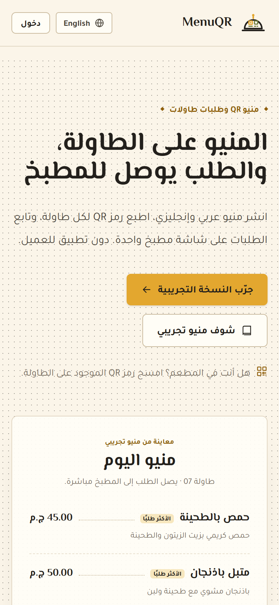
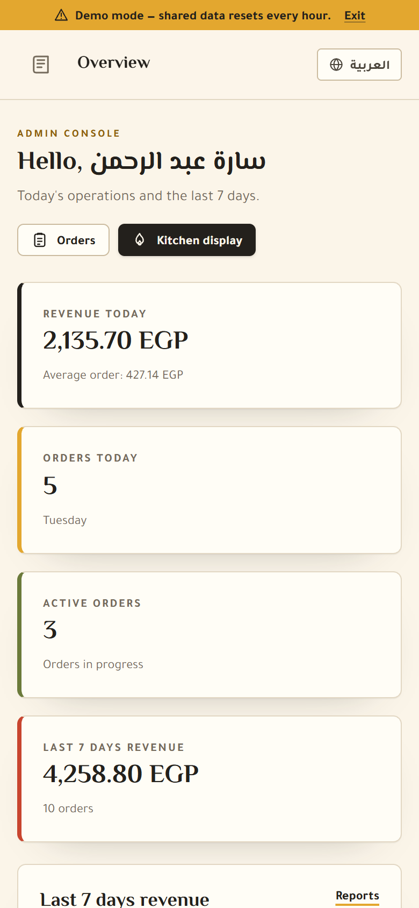

# MenuQR

QR menus and table ordering for restaurants and cafés, with a live kitchen screen.

<p align="center"></p>

A guest scans the QR code on the table, browses a menu laid out like a printed card, picks dishes and options and sends the order. It appears in the kitchen as a large ticket, and the cashier moves it from new to preparing, ready and served.

The demo restaurant is **Zaytouna**, a fictional Levantine kitchen in Nasr City with 42 dishes across seven categories.

The interface is Arabic-first (right-to-left) with a complete English version.

## Highlights

- **Mobile menu** designed like a printed card, with a sticky cart bar, options and notes, dine-in or takeaway.
- **Server-side pricing:** every price and option is recalculated on the server when the order is placed.
- **Kitchen display:** high-contrast tickets that refresh every 10 seconds, with status buttons per role.
- **Tables and QR codes:** a random 48-character token per table, SVG download, an A4 print sheet and token regeneration.
- **Menu management:** bilingual categories and dishes, images, option groups with price changes, availability and sorting.
- **Reports:** sales by day, dish and category, top sellers and average order value, with CSV export.
- **Installable web app** that keeps the menu readable offline.
- **Roles:** Admin, Cashier and Kitchen.

## Screenshots

**Dashboard** · Arabic



**Kitchen display** · English



**Menu items** · English



**Tables and QR codes** · English



**Restaurant site** · Arabic



**On mobile** (English and Arabic)

<p>
  
  
  
</p>

## Tech stack

| Layer | Technology |
| --- | --- |
| Backend | PHP 8.4, Laravel 13 |
| Frontend | Blade, Tailwind CSS 4, Alpine.js 3 (CSP build), Vite 8 |
| Database | SQLite |
| QR codes | endroid/qr-code (MIT) |
| Fonts | El Messiri and Tajawal, self-hosted |
| Tests | PHPUnit feature tests |

No CDNs, trackers or analytics. All fonts and assets are self-hosted.

## Running locally

Requirements: PHP 8.3+ with the `pdo_sqlite`, `sqlite3`, `mbstring`, `fileinfo` and `zip` extensions, Composer 2, Node.js 24 and npm.

```bash
composer install
cp .env.example .env
php artisan key:generate
touch database/database.sqlite
php artisan migrate --seed
php artisan storage:link
npm install
npm run build
php artisan serve
```

Then open http://127.0.0.1:8000.

Full setup notes are in [INSTALL.md](INSTALL.md).

## Demo access

The home page and sign-in page have a **Try the demo** action for Admin, Cashier and Kitchen. Demo data resets every hour (`php artisan demo:reset`). Set `DEMO_MODE=false` in `.env` to remove the demo entry points.

All names, phone numbers, emails and records in the demo are fictional sample data.

## Tests

```bash
php artisan test
```

128 automated tests, all passing at the time of publishing. Details in [TESTING.md](TESTING.md).

## Documentation

- [INSTALL.md](INSTALL.md)
- [TESTING.md](TESTING.md)
- [SECURITY.md](SECURITY.md)
- [ROADMAP.md](ROADMAP.md)
- [docs/ARCHITECTURE.md](docs/ARCHITECTURE.md)
- [docs/DECISIONS.md](docs/DECISIONS.md)
- [THIRD-PARTY-NOTICES.md](THIRD-PARTY-NOTICES.md)

## License

Copyright © 2026 Fedaa Mohamed. All rights reserved.

This repository is public so the code can be reviewed. It is **not open source**: no permission is granted to use, copy, modify, distribute or sell any part of it without prior written permission. See [LICENSE](LICENSE). Third-party libraries and fonts keep their own licences, listed in [THIRD-PARTY-NOTICES.md](THIRD-PARTY-NOTICES.md).

---

Designed & built by [Fedaa Mohamed](https://fedaamohamed.com).
